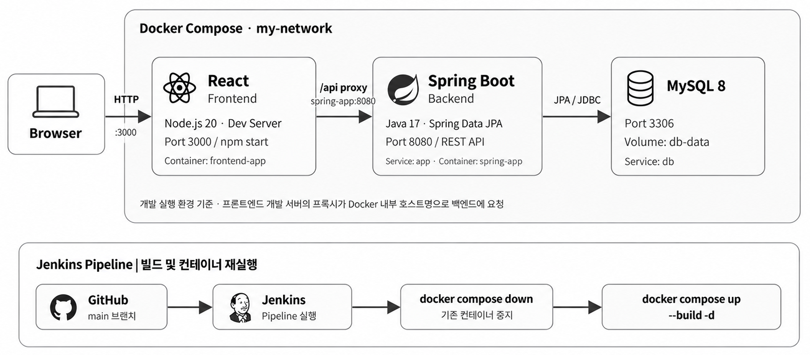

# 📅 Scheduling

React와 Spring Boot로 구현한 **일정·Todo 관리 웹 애플리케이션**입니다.

기능 구현과 함께 **Docker Compose로 프론트엔드·백엔드·MySQL 실행 환경을 구성**하고, 컨테이너 간 API 통신 문제를 해결했습니다. 또한 백엔드의 **Multi-stage Build**와 **Jenkins Pipeline**을 이용해 이미지 빌드 및 컨테이너 재실행 과정을 구성했습니다.

---

## 🛠 Tech Stack

| 구분 | 기술 |
|---|---|
| Backend | Java 17, Spring Boot 3.5.3, Spring Data JPA |
| Frontend | React, JavaScript, React Router, React Calendar |
| Database | MySQL 8 |
| Infrastructure | Docker, Docker Compose |
| CI/CD | Jenkins |
| Build / API | Gradle, Springdoc OpenAPI (Swagger UI) |

---

## 🗺 시스템 아키텍처



```text
Browser (:3000)
    ↓
React Dev Server (frontend)
    ├── /api 요청 프록시 ──→ Spring Boot (app:8080)
    │                                ↓
    │                          MySQL (db:3306)
    └── 웹 화면 제공

Jenkins Pipeline 실행
    ↓
GitHub main 브랜치 체크아웃
    ↓
docker compose down
    ↓
docker compose up --build -d
```

- `frontend`, `app`, `db`는 Docker Compose의 `my-network`에서 통신합니다.
- MySQL 데이터는 `db-data` 볼륨에 저장하고, DB 헬스 체크 이후 백엔드를 시작하도록 구성했습니다.
- 현재 프론트엔드는 **React 개발 서버(`npm start`)로 실행**됩니다. 운영용 정적 파일 서빙 구조와는 구분됩니다.

---

## 1. Docker 환경의 API 통신 문제 해결

React 개발 서버와 Spring Boot를 각각 컨테이너로 분리한 뒤, 기존 `localhost` 기반 프록시 주소로는 백엔드에 요청을 전달할 수 없었습니다.

컨테이너 내부의 `localhost`는 해당 컨테이너 자신을 가리키므로, 프록시 대상을 Docker Compose에서 접근 가능한 백엔드 컨테이너명으로 변경했습니다.

**`frontend/package.json`**

```json
"proxy": "http://spring-app:8080"
```

브라우저의 `/api` 요청을 React 개발 서버가 받아 `spring-app:8080`으로 전달하도록 구성했습니다.

---

## 2. Multi-stage Build

백엔드 Dockerfile에서 **Gradle 빌드 단계**와 **애플리케이션 실행 단계**를 분리했습니다.

**`backend/Dockerfile`**

```dockerfile
FROM gradle:8.14.3-jdk17 AS builder
WORKDIR /app
COPY . .
RUN gradle build -x test

FROM eclipse-temurin:17-jdk-alpine
WORKDIR /app
COPY --from=builder /app/build/libs/*.jar app.jar
ENTRYPOINT ["java", "-jar", "app.jar"]
```

이미지 빌드 시 JAR를 생성하고, 실행 단계에는 생성된 JAR만 복사합니다.

> 현재 Docker 이미지 빌드 명령은 `-x test`를 사용하여 테스트 실행을 제외합니다.

---

## 3. Jenkins Pipeline

`Jenkinsfile`에 GitHub 소스 갱신과 Docker Compose 기반 컨테이너 재실행 절차를 정의했습니다.

```text
Jenkins Pipeline 실행
→ GitHub main 브랜치 가져오기
→ docker compose down
→ docker compose up --build -d
```

코드 갱신부터 이미지 재빌드와 컨테이너 실행까지 한 번의 Pipeline으로 수행합니다.

> 저장소의 Jenkinsfile에는 별도의 테스트 단계, GitHub push 자동 트리거, 무중단 배포 설정이 포함되어 있지 않습니다.

---

## 4. 주요 기능

| 영역 | 구현 내용 |
|---|---|
| 일정 | 등록·수정·논리 삭제, 일별·월별 조회 |
| 일정 우선순위 | 기준일부터 4일 이내 마감 일정 조회 및 잔여 일수에 따른 우선순위 계산 |
| Todo | 등록·수정·논리 삭제, 완료 여부 변경, 날짜별 조회 |
| 화면 | React Calendar 기반 날짜 선택 및 일정 표시 |

**데이터 모델**은 `schedule`, `todoList` 엔티티로 구성되며, Todo는 `scheduleSeq` 값을 통해 일정과 연결할 수 있습니다.

---

## 5. 실행 방법

저장소를 복제한 뒤 루트 디렉터리에 `.env` 파일을 작성합니다.

```bash
git clone https://github.com/sejinzx/scheduling.git
cd scheduling
```

**`.env` 예시** (실제 비밀번호로 교체)

```dotenv
MYSQL_DATABASE=scheduling
MYSQL_USER=app_user
MYSQL_PASSWORD=change_me
MYSQL_ROOT_PASSWORD=change_me_root
```

```bash
docker compose up --build -d
```

| 서비스 | 접속 주소 |
|---|---|
| React | http://localhost:3000 |
| Spring Boot | http://localhost:8080 |
| Swagger UI | http://localhost:8080/swagger-ui/index.html |

종료할 때는 `docker compose down`을 사용합니다. `down -v`는 DB 볼륨도 삭제할 수 있으므로 주의해야 합니다.

---

## 📄 관련 코드

- [Docker Compose](./docker-compose.yml)
- [Backend Dockerfile](./backend/Dockerfile)
- [React 프록시 설정](./frontend/package.json)
- [Jenkins Pipeline](./Jenkinsfile)
- [일정 Controller](./backend/src/main/java/com/sejinzx/scheduling/schedule/controller/ScheduleController.java)
- [Todo Controller](./backend/src/main/java/com/sejinzx/scheduling/todo/controller/ToDoListController.java)
